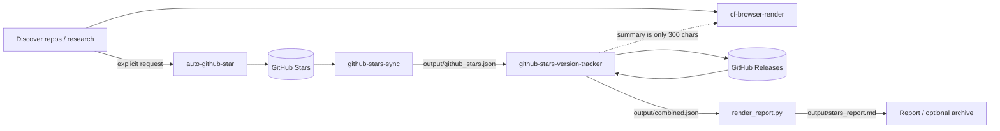

# LLM Wiki Skills

> **Turn any web page into AI-friendly Markdown, and keep your GitHub Stars organized.**
>
> Four composable Agent Skills for Claude Code and DeepSeek Harness (DSH).
> **Zero third-party Python dependencies**, individually installable, local `.env` only.

[](LICENSE)


By 小妖刀 · GitHub [@wJJh](https://github.com/wJJh)

[中文](README.md) · [License](LICENSE) · [.env template](.env.example) ·
[Credential guides](docs/credentials/README.md)

---

## Quick start (30 seconds)

Requirements: Python 3.10+ and a Cloudflare account.

```bash
git clone https://github.com/wJJh/llm-wiki-skills.git
cd llm-wiki-skills
cp .env.example .env
# edit .env:
#   CF_BROWSER_RENDERING_TOKEN=...
#   CF_ACCOUNT_ID=...
python skills/cf-browser-render/scripts/fetch_markdown.py \
  "https://example.com" -o article.md
```

> PowerShell: replace the trailing `\` with a backtick, or put the command on one line.
>
> **Mainland China / restricted networks:** set `HTTPS_PROXY` in `.env` or add
> `--proxy http://127.0.0.1:7890`; direct access to `api.cloudflare.com` may time out.

Create a Cloudflare token at Dashboard → My Profile → API Tokens with
**Account > Browser Rendering > Edit** permission. Full steps:
[Cloudflare credential guide](docs/credentials/cloudflare-browser-rendering.md).

---

## Why it matters

| What you get | Details |
|---|---|
| **Web → Markdown** | WeChat articles, GitHub repository pages, blogs, docs, and SPAs |
| **Four composable skills** | Research → manual star → export Stars → release tracking → report |
| **Zero dependencies** | Python 3.10+ standard library only; no `pip install` |
| **Install just one** | `cf-browser-render` is a complete standalone tool |
| **Local `.env`** | No global environment variables; credentials stay local |
| **Claude Code + DSH** | The same `SKILL.md` works in both agents |

> **Only need web-to-Markdown?** Install `cf-browser-render` alone; the other three are optional.

---

## Contents

- [Quick start](#quick-start-30-seconds)
- [Why install cf-browser-render on its own](#why-install-cf-browser-render-on-its-own)
- [The four skills](#the-four-skills)
- [How they work together](#how-they-work-together)
- [Prerequisites](#prerequisites)
- [Install](#install)
- [Environment and credentials](#environment-and-credentials)
- [Security](#security)
- [Development](#development)
- [License](#license)

---

## Why install cf-browser-render on its own

**It is not a knowledge-base-only tool.** It fits any workflow that turns a web
page into text an AI can read:

| Use case | What it does |
|---|---|
| **WeChat articles** | Convert publicly accessible articles into clean Markdown for summaries and archives |
| **GitHub repository pages** | Turn READMEs, releases, and docs into Markdown for AI comparison and research reports |
| **Technical blogs / official docs** | Preserve headings, lists, tables, code blocks, and links |
| **SPAs / JavaScript pages** | Rendered by a real browser, not a simple HTTP fetch |
| **Batch clipping** | Fetch multiple URLs serially and save each as `.md` |
| **AI pipelines** | Feed RAG, note systems, code assistants, summarizers, or translators |

### Why Markdown is AI-friendly

- Keeps structure: headings, lists, tables, code blocks, quotes, links
- Removes HTML noise: far fewer tags, scripts, styles, and inline attributes
- Easy to chunk by heading level for RAG and long-document summaries
- Easy to trace: links and code blocks remain intact
- Plain text: works with Git, Obsidian, and any editor

### Customize it for your workflow

All four skills are MIT-licensed and easy to adapt:

- **Triggers**: edit `description` / `whenToUse` in `skills/<name>/SKILL.md`
- **Output**: `-o article.md`, multiple URLs, `--timeout`
- **API endpoint**: swap `/browser-rendering/markdown` for `/screenshot`, `/pdf`,
  `/content`, or `/scrape` (advanced; edit `fetch_markdown.py`)
- **Post-processing**: add frontmatter, derive filenames from page titles, strip
  navigation chrome, build batch manifests
- **Stars skills**: adjust `CATEGORY_KEYWORDS`, exclusions, batch size, report template
- **Environment isolation**: use different `.env` files with `--env-file`

> See the [cf-browser-render skill README](skills/cf-browser-render/README.md) and
> the [Cloudflare credential guide](docs/credentials/cloudflare-browser-rendering.md).

---

## The four skills

| Skill | What it does |
|---|---|
| **cf-browser-render** ⭐ | Render any web page into Markdown with Cloudflare Browser Rendering. Handles WeChat articles, SPAs, docs, and GitHub pages. |
| **github-stars-sync** | Export starred repositories as JSON, Markdown, and language statistics. |
| **github-stars-version-tracker** | Batch-check new releases across starred repos, filter by category, and generate a Markdown report. |
| **auto-github-star** | Star repositories only when explicitly requested. |

---

## How they work together

1. **cf-browser-render** turns pages, repos, and release notes into Markdown for research.
2. **auto-github-star** adds repositories to Stars only when you explicitly ask.
3. **github-stars-sync** exports everything to `output/github_stars.json`.
4. **github-stars-version-tracker** compares releases, writes `output/combined.json`,
   and renders `output/stars_report.md`.
5. When a 300-character release summary is not enough, **cf-browser-render** fetches the full page.



Data flow:

1. `github-stars-sync` exports `output/github_stars.json`.
2. `github-stars-version-tracker` compares releases against
   `output/github_stars_latest.json` and writes `output/combined.json`.
3. `render_report.py` produces `output/stars_report.md`.
4. `cf-browser-render` can fetch the full release page when the 300-character
   summary is not enough.
5. `auto-github-star` is the manual intake step; it never runs automatically.

Use only `cf-browser-render` for pure web research. Add the two Stars skills for
version monitoring. Install all four for the full loop.

---

## Prerequisites

### Minimum requirements

| Requirement | Minimum | Notes |
|---|---|---|
| Python | **3.10+** (3.12/3.13 recommended) | Standard library only; **no `pip install`** |
| OS | Windows / macOS / Linux | Scripts are cross-platform; Windows UTF-8 is handled |
| Network | Access to GitHub / Cloudflare | **Cloudflare API may require a proxy IP on some networks (especially mainland China)**; set `HTTPS_PROXY` |
| Account | Per skill | Cloudflare for `cf-browser-render`; GitHub for Stars skills |
| Git (optional) | Any recent version | For `git clone`; otherwise download the ZIP |
| Agent (optional) | Claude Code or DSH | Not required if you run the scripts directly |

### Network and proxy (important)

`api.cloudflare.com` may time out, reset connections, or be restricted on some
networks (especially mainland China or restricted egress IPs). Configure a
working HTTP/HTTPS proxy for `cf-browser-render`:

```dotenv
# Local mixed port from Clash/V2Ray or another HTTP proxy
HTTPS_PROXY=http://127.0.0.1:7890
# Optional
HTTP_PROXY=http://127.0.0.1:7890
NO_PROXY=localhost,127.0.0.1
```

Or pass it directly:

```bash
python skills/cf-browser-render/scripts/fetch_markdown.py \
  --proxy http://127.0.0.1:7890 "https://example.com"
```

- Only HTTP/HTTPS proxies are supported; expose SOCKS5 as a local HTTP mixed port.
- If 403/1020 persists, try a different egress IP; Cloudflare may block datacenter
  or abused proxy IPs.
- Use a trusted proxy. The API is HTTPS, but a malicious proxy with a trusted root
  certificate could inspect traffic.
- GitHub skills use `GITHUB_PROXY`; Cloudflare uses `HTTPS_PROXY`.

### Check Python

```bash
python --version     # Windows
python3 --version    # macOS / Linux
py --version         # Windows launcher
```

Expected: `Python 3.10.x` or newer.

> Commands below use `python`; on macOS/Linux, use `python3` if that is the only command available.

**Windows:** install from <https://www.python.org/downloads/> and check
**Add python.exe to PATH**.

**macOS:** `brew install python`, or use the python.org installer.

**Linux (Debian/Ubuntu):** `sudo apt update && sudo apt install python3`.

> No third-party Python packages are required.

### Prepare by usage

| Usage | What you need |
|---|---|
| `cf-browser-render` only | Python 3.10+ and a Cloudflare account with Browser Rendering |
| Stars skills only | Python 3.10+ and a GitHub account + Personal Access Token |
| As Claude Code skills | Claude Code plus the requirements above |
| As DSH skills | DeepSeek Harness plus the requirements above |
| Run scripts directly | No Claude Code or DSH needed |
| Optional DSH pnpm bundle / CI | Node.js 22+ and pnpm |

### Credentials

- [Cloudflare Browser Rendering credentials](docs/credentials/cloudflare-browser-rendering.md)
- [GitHub Personal Access Token](docs/credentials/github-token.md)
- [Credential overview and security rules](docs/credentials/README.md)

### Agent installation (optional)

- Claude Code: <https://claude.com/claude-code>
- DeepSeek Harness: <https://github.com/deepseek-ai/deepseek-harness>

> If you only need web-to-Markdown, you can run
> `skills/cf-browser-render/scripts/fetch_markdown.py` directly without an agent.

---

## Install

### Claude Code plugin marketplace

```text
/plugin marketplace add wJJh/llm-wiki-skills

# Install one skill
/plugin install cf-browser-render@llm-wiki-skills
/plugin install github-stars-sync@llm-wiki-skills
/plugin install github-stars-version-tracker@llm-wiki-skills
/plugin install auto-github-star@llm-wiki-skills

# Or install all four
/plugin install all-skills@llm-wiki-skills
```

Plugin caches contain Git content only; a repo-root `.env` is not copied into
the cache. For persistent local credentials, prefer a clone + manual/junction
install, or pass `--env-file /path/to/.env`.

### Claude Code manual install

```bash
git clone https://github.com/wJJh/llm-wiki-skills.git

# One skill (user level)
cp -r llm-wiki-skills/skills/cf-browser-render ~/.claude/skills/

# All skills
cp -r llm-wiki-skills/skills/* ~/.claude/skills/
```

Windows junction:

```powershell
New-Item -ItemType Junction `
  -Path "$env:USERPROFILE\.claude\skills\cf-browser-render" `
  -Target "D:\path\llm-wiki-skills\skills\cf-browser-render"
```

> If `~/.claude/skills` does not exist, create it first with
> `New-Item -ItemType Directory -Force "$env:USERPROFILE\.claude\skills"`.

### DSH (DeepSeek Harness)

DSH scans these skill roots (highest priority first):

| Priority | Path |
|---|---|
| 100 | `<project>/.dsh/skills` |
| 200 | `<project>/.agents/skills` |
| 400 | `~/.dsh/skills` |
| 500 | `~/.agents/skills` |

```bash
# All skills, user level
mkdir -p ~/.dsh/skills
cp -r llm-wiki-skills/skills/* ~/.dsh/skills/
```

```powershell
# One skill on Windows
New-Item -ItemType Junction `
  -Path "$env:USERPROFILE\.dsh\skills\cf-browser-render" `
  -Target "D:\path\llm-wiki-skills\skills\cf-browser-render"
```

> If `~/.dsh/skills` does not exist, create it first with
> `New-Item -ItemType Directory -Force "$env:USERPROFILE\.dsh\skills"`.

DSH scans one level only (`<root>/<name>/SKILL.md`). `watch` is enabled by default,
so changes usually appear on the next model step; start a new session if they don't.

#### Optional: pnpm bundle

```powershell
cd "$env:USERPROFILE\.dsh\profiles\desktop"
pnpm add github:wJJh/llm-wiki-skills
# update
pnpm update dsh-llm-wiki-skills
```

Then add `"dsh-llm-wiki-skills"` to the profile's `dsh.profile.bundles` array and
restart DSH. This is an advanced option; use the filesystem install if pnpm is
not available.

---

## Environment and credentials

```bash
cp .env.example .env
```

Priority (highest first):

1. Process environment variables
2. `--env-file /path/to/.env`
3. Skill directory `.env`
4. Skills root `.env` (e.g. `~/.claude/skills/.env`)
5. Repository root `.env`

Skills do **not** scan the current working directory or host-project `.env` files.
Only whitelisted keys are loaded; `ANTHROPIC_*` and other unrelated variables are ignored.

| Variable | Used by | Required | Notes |
|---|---|---|---|
| `GITHUB_TOKEN` | Stars skills | Yes | Classic PAT with `public_repo` |
| `GITHUB_USERNAME` | Stars exporters | No | Auto-detected via `GET /user` if empty |
| `GITHUB_PROXY` | Stars skills | No | e.g. `http://127.0.0.1:7890` |
| `OUTPUT_DIR` | sync / tracker / report | No | Default `./output` |
| `CF_BROWSER_RENDERING_TOKEN` | cf-browser-render | Yes | Browser Rendering token |
| `CF_ACCOUNT_ID` | cf-browser-render | Yes | Cloudflare Account ID |
| `HTTPS_PROXY` | cf-browser-render | Required on some networks | HTTP/HTTPS proxy for Cloudflare access |

### How to obtain credentials

| Credential | Detailed guide |
|---|---|
| Cloudflare Browser Rendering token + Account ID | [Cloudflare credential guide](docs/credentials/cloudflare-browser-rendering.md) |
| GitHub Personal Access Token | [GitHub credential guide](docs/credentials/github-token.md) |
| `.env` placement, proxy, security | [Credential overview](docs/credentials/README.md) |

---

## Security

- `.env` is gitignored; the repository only ships `.env.example`.
- Scripts call `api.github.com` and `api.cloudflare.com` directly; no telemetry.
- `cf-browser-render` sends the target URL to Cloudflare Browser Rendering.
- `auto-github-star` runs only on an explicit request.
- Reports are written locally to `OUTPUT_DIR`.

If a token leaks, revoke and rotate it in the GitHub or Cloudflare dashboard.

---

## Development

```bash
python scripts/verify.py
python -m py_compile skills/*/scripts/*.py
node --check index.js
claude plugin validate . --strict
```

CI runs `.github/workflows/verify.yml` with no secrets.

---

## License

[MIT](LICENSE)

## Acknowledgements

- [anthropics/skills](https://github.com/anthropics/skills) — Claude Code skill format and marketplace layout
- [Aurirlk/Aurirlk-DSH-skills](https://github.com/Aurirlk/Aurirlk-DSH-skills) — DSH bundle organization
- [hackerFish/awesome-dsh-skills](https://github.com/hackerFish/awesome-dsh-skills) — DSH skill roots and validation ideas

All four skills are original to this project. See the [Chinese README](README.md)
for detailed per-skill documentation.
