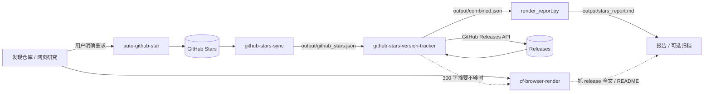

# LLM Wiki Skills

> **把任意网页变成 AI 能读的 Markdown，顺手管理你的 GitHub Stars。**
>
> 四个可组合的 Agent Skills，支持 Claude Code 与 DeepSeek Harness（DSH），
> **零第三方 Python 依赖**；可以只装一个，也可以四个联动。

[](LICENSE)


作者：小妖刀 · GitHub [@wJJh](https://github.com/wJJh)

[English](README.en.md) · [许可证](LICENSE) · [环境变量模板](.env.example) ·
[凭据获取指南](docs/credentials/README.md)

---

## 30 秒上手

前置：Python 3.10+，一个 Cloudflare 账号。

```bash
git clone https://github.com/wJJh/llm-wiki-skills.git
cd llm-wiki-skills
cp .env.example .env
# 编辑 .env：
#   CF_BROWSER_RENDERING_TOKEN=...
#   CF_ACCOUNT_ID=...
python skills/cf-browser-render/scripts/fetch_markdown.py \
  "https://example.com" -o article.md
```

> PowerShell 用户：把行尾的 `\` 换成反引号 `` ` ``，或把命令写成一行。
>
> **国内网络提示**：访问 `api.cloudflare.com` 通常需要代理 IP；先在 `.env` 设置
> `HTTPS_PROXY`，或加 `--proxy http://127.0.0.1:7890`，否则可能超时。

Token 获取：Cloudflare Dashboard → My Profile → API Tokens，
权限选 **Account > Browser Rendering > Edit**。完整步骤见
[Cloudflare 凭据指南](docs/credentials/cloudflare-browser-rendering.md)。

输出示例：

```markdown
# 文章标题

正文内容...

## 小标题

- 列表项 1
- 列表项 2
```

---

## 为什么值得

| 你能得到什么 | 说明 |
|---|---|
| **网页 → Markdown** | 公众号文章、GitHub 仓库主页、技术博客、官方文档、SPA 都能抓 |
| **四个技能可组合** | 网页研究 → 手动 Star → 导出 Stars → 版本追踪 → 报告 |
| **零第三方依赖** | Python 3.10+ 标准库即可，不需要 `pip install` |
| **可以只装一个** | `cf-browser-render` 是最亮的入口，单独安装就能用 |
| **本地 `.env`** | 不需要配置全局环境变量；凭据只留在本地 |
| **Claude Code + DSH** | 同一套 `SKILL.md`，两个 Agent 都能加载 |

> **只想要网页转 Markdown？** 只装 `cf-browser-render` 就够了，不需要另外三个技能。

---

## 目录

- [30 秒上手](#30-秒上手)
- [为什么单独装 cf-browser-render](#为什么单独装-cf-browser-render)
- [四个技能](#四个技能)
- [四技能如何联动](#四技能如何联动)
- [使用前提](#使用前提)
- [安装](#安装)
- [环境变量与凭据](#环境变量与凭据)
- [使用示例](#使用示例)
- [目录结构](#目录结构)
- [安全与隐私](#安全与隐私)
- [常见问题](#常见问题)
- [开发与校验](#开发与校验)
- [许可证](#许可证)

---

## 为什么单独装 cf-browser-render

**它不是知识库专属工具。** 凡是“把网页变成 AI 能读的文本”的场景都能用：

| 场景 | 能做什么 |
|---|---|
| **微信公众号文章** | 把公开可访问的文章转成干净 Markdown，方便总结、归档、二次创作 |
| **GitHub 仓库主页** | README、Release、文档页转 Markdown，方便让 AI 对比仓库、写调研报告 |
| **技术博客 / 官方文档** | 保留标题层级、列表、表格、代码块和链接 |
| **SPA / JavaScript 页面** | 真实浏览器渲染，不是简单 HTTP 抓取 |
| **批量剪藏** | 多个 URL 串行抓取，统一保存成 `.md` |
| **AI 工作流** | 输出可直接喂给 RAG、知识库、代码助手、摘要/翻译流程 |

### 为什么 Markdown 对 AI 友好

- **结构保留**：标题、列表、表格、代码块、引用和链接都在
- **噪声更少**：比 HTML 少掉大量标签、脚本、样式和内联属性，更省 context
- **易切分**：按标题层级就能做 chunk，适合 RAG 和长文总结
- **易溯源**：链接和代码块保留，方便回查原文
- **易存储**：纯文本，Git、Obsidian、任何编辑器都能直接读

### 按自己的场景微调

四个技能都是 MIT，可以直接改，不用重新造轮子：

- **触发词**：编辑 `skills/<name>/SKILL.md` 的 `description` / `whenToUse`
- **输出方式**：`-o article.md` 保存单文件；多个 URL 串行；`--timeout` 调超时
- **API 端点**：把 `/browser-rendering/markdown` 换成 `/screenshot`、`/pdf`、
  `/content`、`/scrape` 等（进阶，需要改 `fetch_markdown.py`）
- **后处理**：加 frontmatter、按网页标题生成文件名、清理导航栏、批量清单
- **Stars 技能**：改 `CATEGORY_KEYWORDS`、排除词、批次大小、报告模板
- **环境隔离**：用不同 `.env` + `--env-file` 区分工作/个人/测试场景

> 不想改代码也可以：`--env-file` 指向不同配置，或在 `.env` 里切换代理和输出目录。
> 详见 [cf-browser-render 技能说明](skills/cf-browser-render/README.md) 和
> [Cloudflare 凭据指南](docs/credentials/cloudflare-browser-rendering.md)。

---

## 四个技能

| 技能 | 一句话 | 单独安装 |
|---|---|---|
| **cf-browser-render** ⭐ | 用真实浏览器把任意网页渲染成 Markdown，公众号/SPA/文档/GitHub 都能抓 | [插件安装](#安装) 或 [手动](skills/cf-browser-render/README.md#安装) |
| **github-stars-sync** | 分页导出 GitHub Stars，生成 JSON / Markdown / 语言统计 | [README](skills/github-stars-sync/README.md) |
| **github-stars-version-tracker** | 批量扫描 Star 仓库的新版本，分类过滤并生成报告 | [README](skills/github-stars-version-tracker/README.md) |
| **auto-github-star** | 只在明确要求时手动 Star 仓库 | [README](skills/auto-github-star/README.md) |

**亮点 `cf-browser-render`**：零依赖、一条命令、Windows 自动 UTF-8，适合公众号文章、
JavaScript 渲染的 SPA、文档站和 GitHub 页面。

---

## 四技能如何联动

四个技能不是四个孤岛，而是一条完整流水线：

1. **cf-browser-render** 先把网页/仓库/Release 抓成 Markdown，用于研究和判断。
2. **auto-github-star** 在你明确要求时把值得收藏的仓库加入 Stars（不会自动触发）。
3. **github-stars-sync** 把 Stars 全量导出成 `output/github_stars.json`。
4. **github-stars-version-tracker** 读取快照、分批扫描 Releases，生成
   `output/combined.json` 和 `output/stars_report.md`。
5. 遇到只有 300 字摘要的 Release，再用 **cf-browser-render** 抓全文补全。



### 数据契约

| 文件 | 生产者 | 消费者 | 内容 |
|---|---|---|---|
| `output/github_stars.json` | `github-stars-sync` / tracker 的 fetch | `github-stars-version-tracker` | Stars 全量列表，含 `full_name`、`stars`、`language`、`starred_at` |
| `output/github_stars_latest.json` | `scan_all.py` | `check_versions.py` | 上次扫描的全部仓库最新 tag/date |
| `output/combined.json` | `scan_all.py` | `render_report.py` / 人工 | 本次更新、分类、错误统计、是否完整 |
| `output/stars_report.md` | `render_report.py` | 人 / 笔记库 | 按类别分组的 Markdown 报告 |

### 组合场景

| 组合 | 适合 |
|---|---|
| 只装 `cf-browser-render` | 纯网页研究、公众号/SPA 剪藏、零依赖 |
| `cf-browser-render` + `github-stars-sync` | 研究仓库并建立个人 Stars 画像 |
| `github-stars-sync` + `github-stars-version-tracker` | 只做版本监控 |
| 四个全装 | 发现 → 手动 Star → 导出 → 版本扫描 → 抓全文深挖 |

> `auto-github-star` **只手动触发**：不会因为消息里出现链接就自动 Star。
> `cf-browser-render` 既可独立使用，也可为版本报告的 300 字 Release 摘要补全全文。

---

## 使用前提

### 最低要求

| 项目 | 要求 | 说明 |
|---|---|---|
| Python | **3.10+**（推荐 3.12 / 3.13） | 四个技能只用标准库，**不需要 `pip install`** |
| 操作系统 | Windows / macOS / Linux | 脚本跨平台；Windows 已自动处理 UTF-8 |
| 网络 | 能访问 GitHub / Cloudflare | **Cloudflare API 在部分网络（尤其国内）需要代理 IP**；在 `.env` 配置 `HTTPS_PROXY` |
| 账号 | 按技能准备 | `cf-browser-render` 需要 Cloudflare 账号；Stars 技能需要 GitHub 账号 |
| Git（可选） | 任意较新版本 | 用于 `git clone`；不装可直接下载 ZIP |
| Agent（可选） | Claude Code 或 DSH | 只在终端跑脚本的话不需要 |

### 网络与代理（重要）

`api.cloudflare.com` 在部分网络环境（尤其中国大陆、受限出口 IP）可能**超时、连接重置或被限制**。
`cf-browser-render` 需要配置可用的代理 IP 才能稳定访问。

在 `.env` 中配置：

```dotenv
# HTTP/HTTPS 代理（Clash/V2Ray 等客户端的本地混合端口）
HTTPS_PROXY=http://127.0.0.1:7890
# 可选
HTTP_PROXY=http://127.0.0.1:7890
NO_PROXY=localhost,127.0.0.1
```

或命令行直接指定：

```bash
python skills/cf-browser-render/scripts/fetch_markdown.py \
  --proxy http://127.0.0.1:7890 "https://example.com"
```

说明：

- 只支持 **HTTP/HTTPS 代理**；SOCKS5 请先在代理客户端开启本地 HTTP 混合端口（如 Clash 的 mixed-port）。
- 如果持续出现 403/1020，尝试更换出口 IP；Cloudflare 可能限制数据中心或被滥用的代理 IP。
- 代理能看到你的请求；请使用可信代理。API 走 HTTPS，Token 不会明文，但不要使用会安装根证书的不可信代理。
- GitHub 技能用 `GITHUB_PROXY`，Cloudflare 用 `HTTPS_PROXY`。

### 检查 Python

```bash
python --version     # Windows
python3 --version    # macOS / Linux
py --version         # Windows 的 py 启动器
```

应输出 `Python 3.10.x` 或更高；低于 3.10 请先升级。

> 下文命令统一写 `python`；macOS/Linux 如果只有 `python3`，请自行替换。

**Windows 安装**

1. 打开 <https://www.python.org/downloads/>
2. 下载 3.12 或 3.13
3. 安装时勾选 **Add python.exe to PATH**
4. 重新打开终端，运行 `python --version` 确认

**macOS**：`brew install python`，或从 python.org 下载安装包。

**Linux（Debian / Ubuntu）**：`sudo apt update && sudo apt install python3`。

> 不需要安装任何 Python 第三方包；四个技能全部使用标准库。

### 按使用方式准备

| 使用方式 | 需要准备 |
|---|---|
| 只跑 `cf-browser-render` | Python 3.10+ + Cloudflare 账号（Browser Rendering 权限） |
| 只跑 Stars 技能 | Python 3.10+ + GitHub 账号 + Personal Access Token |
| 作为 Claude Code 技能 | Claude Code + 上述运行前提 |
| 作为 DSH 技能 | DeepSeek Harness + 上述运行前提 |
| 只在终端跑脚本 | 不需要 Claude Code / DSH |
| DSH pnpm 合集包 / CI（可选） | Node.js 22+、pnpm |

### 获取凭据

- [Cloudflare Browser Rendering 凭据](docs/credentials/cloudflare-browser-rendering.md)
- [GitHub Personal Access Token](docs/credentials/github-token.md)
- [凭据总览与安全规则](docs/credentials/README.md)

### Agent 安装（可选）

- Claude Code：<https://claude.com/claude-code>
- DeepSeek Harness：<https://github.com/deepseek-ai/deepseek-harness>

> 如果只是想把网页转成 Markdown，不装 Agent 也能直接运行
> `skills/cf-browser-render/scripts/fetch_markdown.py`。

---

## 安装

### Claude Code 插件市场（推荐）

```text
/plugin marketplace add wJJh/llm-wiki-skills

# 只装一个（推荐先试 cf-browser-render）
/plugin install cf-browser-render@llm-wiki-skills
/plugin install github-stars-sync@llm-wiki-skills
/plugin install github-stars-version-tracker@llm-wiki-skills
/plugin install auto-github-star@llm-wiki-skills

# 或一次装全
/plugin install all-skills@llm-wiki-skills
```

安装后用自然语言触发即可，例如「用 cf-browser-render 抓这个链接」。

> **插件缓存提示**：插件安装只包含 Git 内容，仓库根 `.env` 不会自动进入插件缓存，
> 更新时也可能覆盖缓存内的 `.env`。需要长期配置 `.env` 时，推荐 clone 后手动/junction 安装，
> 或使用 `--env-file /path/to/.env`。

### Claude Code 手动安装

```bash
git clone https://github.com/wJJh/llm-wiki-skills.git

# 单技能（用户级）
cp -r llm-wiki-skills/skills/cf-browser-render ~/.claude/skills/

# 全量（用户级）
cp -r llm-wiki-skills/skills/* ~/.claude/skills/
```

项目级安装：把技能目录放到 `<项目>/.claude/skills/`。

Windows 可以用 Junction（无需管理员权限）：

```powershell
New-Item -ItemType Junction `
  -Path "$env:USERPROFILE\.claude\skills\cf-browser-render" `
  -Target "D:\path\llm-wiki-skills\skills\cf-browser-render"
```

> 若 `~/.claude/skills` 不存在，先运行
> `New-Item -ItemType Directory -Force "$env:USERPROFILE\.claude\skills"`。

### DSH（DeepSeek Harness）

DSH 扫描以下技能根（优先级从高到低）：

| 优先级 | 路径 | 级别 |
|---|---|---|
| 100 | `<项目>/.dsh/skills` | 项目级 |
| 200 | `<项目>/.agents/skills` | 项目级 |
| 400 | `~/.dsh/skills` | 用户级 |
| 500 | `~/.agents/skills` | 用户级（兼容其它 agent） |

```bash
# 用户级全量（二选一）
mkdir -p ~/.dsh/skills && cp -r llm-wiki-skills/skills/* ~/.dsh/skills/
mkdir -p ~/.agents/skills && cp -r llm-wiki-skills/skills/* ~/.agents/skills/
```

```powershell
# 单技能：Windows Junction
New-Item -ItemType Junction `
  -Path "$env:USERPROFILE\.dsh\skills\cf-browser-render" `
  -Target "D:\path\llm-wiki-skills\skills\cf-browser-render"
```

> 若 `~/.dsh/skills` 不存在，先运行
> `New-Item -ItemType Directory -Force "$env:USERPROFILE\.dsh\skills"`。

```bash
# 单技能：macOS / Linux
mkdir -p ~/.dsh/skills
ln -s /path/to/llm-wiki-skills/skills/cf-browser-render ~/.dsh/skills/cf-browser-render
```

DSH 只扫描一层 `<root>/<name>/SKILL.md`，不支持嵌套目录。`watch` 默认开启，
新增/改名/删除通常在下一次模型步骤刷新；若未出现，再开新会话。

#### 可选：pnpm 合集包（进阶）

```powershell
cd "$env:USERPROFILE\.dsh\profiles\desktop"   # profile 名按实际调整
pnpm add github:wJJh/llm-wiki-skills
# 更新
pnpm update dsh-llm-wiki-skills
```

还需要把 `"dsh-llm-wiki-skills"` 加入该 profile 的 `package.json`：

```json
{
  "dsh": {
    "profile": {
      "bundles": [
        "...",
        "dsh-llm-wiki-skills"
      ]
    }
  }
}
```

然后重启 DSH。此路径依赖 `package.json` + `cordis.patch.yml` + `index.js`，
属于可选/进阶用法；未安装 pnpm 时请使用上面的文件系统安装。

---

## 环境变量与凭据

复制模板：

```bash
cp .env.example .env
```

### `.env` 放哪里

优先级从高到低：

1. **系统环境变量**（最高；已设置的键不会被 `.env` 覆盖）
2. `--env-file /path/to/.env`
3. 技能目录 `.env`，如 `~/.claude/skills/cf-browser-render/.env`
4. 技能根目录 `.env`，如 `~/.claude/skills/.env`、`~/.dsh/skills/.env`
5. 仓库根 `.env`（clone 全量安装，最低）

技能**不会扫描当前工作目录或宿主项目的其它 `.env`**，避免串用别的项目凭据。
`.env` 只加载技能白名单键（GitHub / Cloudflare / 输出目录 / 代理），
不会读取 `ANTHROPIC_*` 等无关变量。

### 变量表

| 变量 | 用于 | 必填 | 说明 |
|---|---|---|---|
| `GITHUB_TOKEN` | stars 三个技能 | 是 | GitHub PAT；经典 Token 勾选 `public_repo` |
| `GITHUB_USERNAME` | stars 两个导出技能 | 否 | 留空则 `GET /user` 自动识别 |
| `GITHUB_PROXY` | stars 三个技能 | 否 | 如 `http://127.0.0.1:7890`，仅当前进程 |
| `OUTPUT_DIR` | sync / tracker / report | 否 | 默认 `./output` |
| `CF_BROWSER_RENDERING_TOKEN` | cf-browser-render | 是 | Cloudflare API Token |
| `CF_ACCOUNT_ID` | cf-browser-render | 是 | Cloudflare Account ID |
| `HTTPS_PROXY` | cf-browser-render 等 | 部分网络必需 | HTTP/HTTPS 代理；国内/受限网络访问 Cloudflare 通常需要 |

### 凭据怎么获取

完整步骤放在独立目录，避免 README 过长：

| 凭据 | 详细步骤 | 说明 |
|---|---|---|
| Cloudflare Browser Rendering Token + Account ID | [Cloudflare 凭据指南](docs/credentials/cloudflare-browser-rendering.md) | 创建 Token、Account ID 位置、权限、401/403/429 排查 |
| GitHub Personal Access Token | [GitHub 凭据指南](docs/credentials/github-token.md) | 经典/细粒度 Token、权限、私有仓库、限流排查 |
| `.env` 位置、代理、安全规则 | [凭据获取总览](docs/credentials/README.md) | 本地配置、优先级、轮换建议 |

> 这里只列四个技能真正使用的变量，不包含 Claude Code 自身的 `ANTHROPIC_*` 配置。

---

## 使用示例

### cf-browser-render

```bash
# 抓公众号文章
python skills/cf-browser-render/scripts/fetch_markdown.py \
  "https://mp.weixin.qq.com/s/xxxxx" -o article.md

# 批量抓取
python skills/cf-browser-render/scripts/fetch_markdown.py url1 url2 url3
```

### github-stars-sync

```bash
# 保存 JSON / Markdown / 统计三份文件
python skills/github-stars-sync/scripts/fetch_stars.py

# 直接输出 JSON
python skills/github-stars-sync/scripts/fetch_stars.py --stdout --format json

# 离线重导出
python skills/github-stars-sync/scripts/fetch_stars.py \
  --input evals/fixtures/sample_stars.json --stdout --format json
```

### github-stars-version-tracker

```bash
# 一键：取 Stars -> 分批扫描 -> 快照 -> 报告
python skills/github-stars-version-tracker/scripts/scan_all.py

# 只看前两批（调试，不更新快照）
python skills/github-stars-version-tracker/scripts/scan_all.py --max-batches 2

# 单独生成报告
python skills/github-stars-version-tracker/scripts/render_report.py \
  --input output/combined.json --output output/stars_report.md
```

### auto-github-star

```bash
# 只在用户明确要求时
python skills/auto-github-star/scripts/star_repo.py owner/repo

# 安全演练
python skills/auto-github-star/scripts/star_repo.py --dry-run owner/repo
```

每个技能的详细说明见 `skills/<name>/README.md`。

---

## 目录结构

```text
llm-wiki-skills/
├── README.md / README.en.md
├── LICENSE
├── .env.example
├── .claude-plugin/marketplace.json   # Claude Code 插件市场（1 合集 + 4 单技能）
├── package.json / cordis.patch.yml / index.js   # DSH 合集包（可选）
├── docs/credentials/                 # Token / Account ID 获取步骤
├── evals/fixtures/                   # 离线测试数据
├── scripts/verify.py                 # 结构 / 密钥 / 语法校验
├── .github/workflows/verify.yml      # CI
└── skills/
    ├── cf-browser-render/
    ├── github-stars-sync/
    ├── github-stars-version-tracker/
    └── auto-github-star/
```

每个技能都是自包含目录：`SKILL.md` + `README.md` + `scripts/`，
内含独立的 `env_loader.py`，因此可以单独复制安装。

---

## 安全与隐私

- **不提交真实密钥**：`.env` 已被 `.gitignore` 忽略；仓库只提供 `.env.example`
- **最小权限**：GitHub Token 只需 `public_repo` / Starring；Cloudflare Token 只需 Browser Rendering Edit
- **本地执行**：脚本只直接请求 `api.github.com` 与 `api.cloudflare.com`，没有第三方遥测
- **URL 会发给 Cloudflare**：使用 `cf-browser-render` 时，目标网页 URL 会发送给 Cloudflare Browser Rendering
- **Star 需要明确同意**：`auto-github-star` 不会自动触发
- **报告本地生成**：版本报告只写到 `OUTPUT_DIR`，不上传任何地方

如果怀疑 Token 泄露，请立即到 GitHub / Cloudflare 控制台撤销并重新生成。

---

## 常见问题

| 问题 | 解决 |
|---|---|
| Windows 中文乱码 | 脚本已自动 `reconfigure(encoding="utf-8")`；仍异常时设置 `PYTHONIOENCODING=utf-8` |
| GitHub 401 | Token 无效或过期，更新 `.env` |
| GitHub 403 / 429 | 限流；降低批大小、增大 `--delay`，或等待重置 |
| Cloudflare 401 / 403 | Token 无效 / 缺少 Browser Rendering Edit 权限 |
| Cloudflare 429 | 配额或速率限制，稍后重试 |
| 代理不生效 | 在 `.env` 设置 `GITHUB_PROXY`（GitHub）或 `HTTPS_PROXY`（Cloudflare） |
| 用户名没填 | 脚本会调用 `GET /user` 自动识别 |
| DSH 看不到技能 | 确认目录是 `<root>/<name>/SKILL.md`（只扫一层）；必要时开新会话 |
| Claude Code 看不到插件 | 先 `/plugin marketplace add`，再 `/plugin install ...`；检查 `/plugin` 列表 |
| 第二次扫描又全是 NEW | 使用新版 `scan_all.py` 生成的快照（列表，含全部扫描仓库） |

---

## 变更说明（相对内部版本）

公开发布版在保持技能行为不变的前提下，做了这些可移植性修复：

- `github-stars-sync` 去掉 `requests`，改为标准库 `urllib`，四个技能全部零第三方依赖
- 移除个人默认值（`GITHUB_USERNAME` 不再硬编码），用户名留空时自动识别
- 移除硬编码项目路径与 `.venv` / Windows 计划任务脚本
- 修复版本快照格式：快照包含全部扫描仓库，第二次运行不会误报 NEW
- 403/429/网络错误标记 `incomplete`，不再混入 `no_release`
- `OUTPUT_DIR` 默认改为 `./output`
- 版本追踪改为生成通用 Markdown 报告，不再强制写入某个 wiki 目录

---

## 开发与校验

```bash
python scripts/verify.py
python -m py_compile skills/*/scripts/*.py
node --check index.js
claude plugin validate . --strict
```

`verify.py` 检查：

- 技能目录、`SKILL.md`、`README.md`、frontmatter
- marketplace / package.json 结构
- 四份 `env_loader.py` 哈希一致
- 无第三方依赖、无 `__pycache__`、无真实密钥与个人路径
- 报告渲染、本地链接

CI 在 `.github/workflows/verify.yml`，不需要任何 secrets。

---

## 许可证

[MIT](LICENSE)

## 参考与致谢

- [anthropics/skills](https://github.com/anthropics/skills)：Claude Code 技能格式与插件市场布局
- [Aurirlk/Aurirlk-DSH-skills](https://github.com/Aurirlk/Aurirlk-DSH-skills)：DSH 合集包组织方式
- [hackerFish/awesome-dsh-skills](https://github.com/hackerFish/awesome-dsh-skills)：DSH 技能根与校验思路

四个技能均为本项目自研；参考仓库仅用于对齐格式与安装方式。
